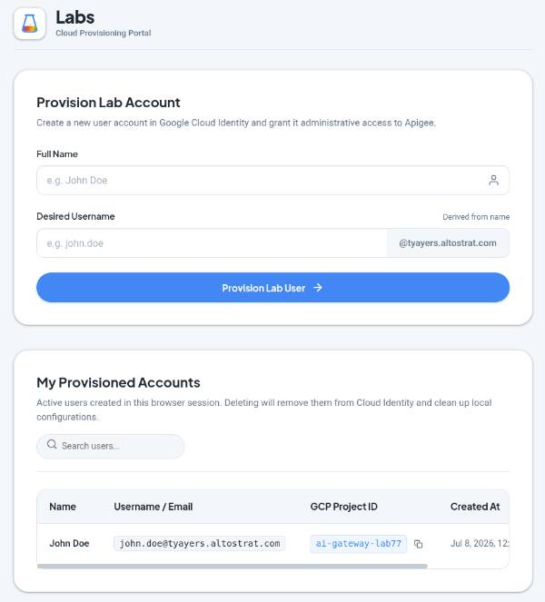

# GCP TempUser
This is a small project to help users self-provision themselves into a Google Cloud project, for example during a hackathon or lab, where anyone should be able to register and get a temp user with certain roles in a Google Cloud project.



The user can manage their user, delete it, and open the Google Cloud console with the project pre-selected.

## Prerequisites

* Go runtime installed to build the service.
* Set environment variables:
    * GOOGLE_CLOUD_PROJECT - your GCP project to host the service.
    * GOOGLE_CLOUD_LOCATION - the region to deploy to.
    * CLOUD_IDENTITY_DOMAIN - the domain of the IAM cloud identity
    * ADMIN_EMAIL - the admin email of the domain
* Services needed:
    * `gcloud services enable iamcredentials.googleapis.com --project $GOOGLE_CLOUD_PROJECT`
    * `gcloud services enable admin.googleapis.com --project $GOOGLE_CLOUD_PROJECT`
    * `gcloud services enable cloudresourcemanager.googleapis.com --project $GOOGLE_CLOUD_PROJECT`
* Create service account user `lab-user` in your target project.
* Assign roles to `lab-user`:
    * roles/resourcemanager.projectIamAdmin
    * roles/iam.serviceAccountTokenCreator
* Get Service Account Unique Id from IAM Service Accounts page
    * Go to the Google Admin, Security, Access and data control, API controls
    * Add the Client Id with the scope `https://www.googleapis.com/auth/admin.directory.user`

## Deploy
Deploy by running `./deploy.sh` script. You will need to take care that the service account user exists and has the correct rights / delegated rights for the Cloud IAM instance to create the user.

```sh
# Deploy to Cloud Run
./deploy.sh
```
